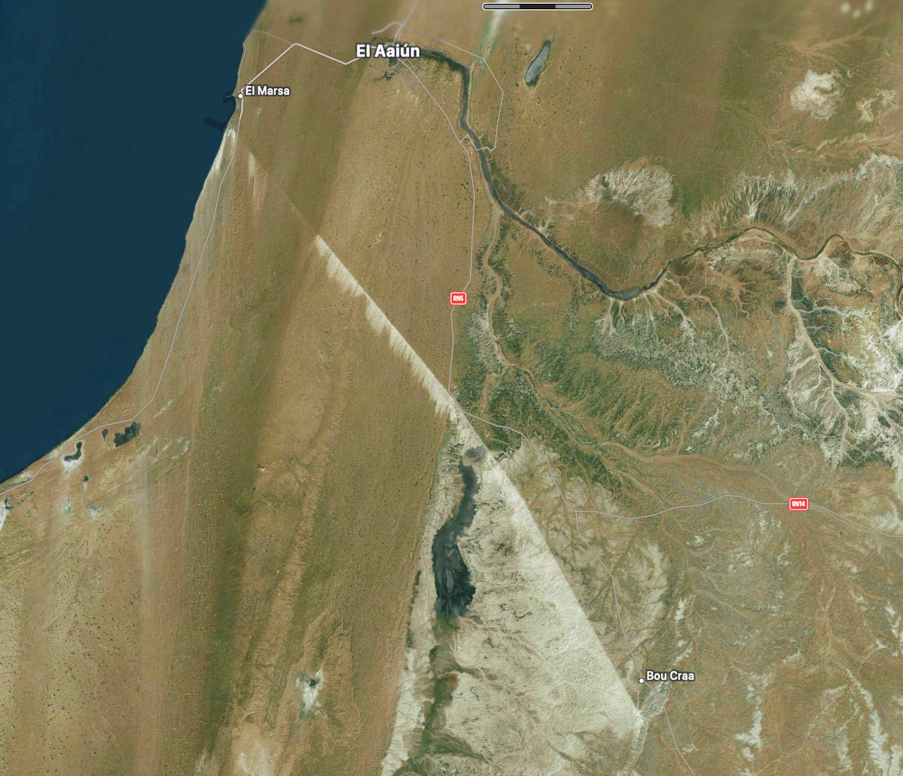

Es una cintra transportadora de exactamente 100km por el desierto desde Bu Craa, en el Sáhara Occidental, hasta El Marsa, a 25km al suroeste de El-Aaiún, donde terminaba en un cargadero que se interna 3km en el mar. 

Se construyó entre 1969 y 1973, año en el que ya funcionaba a pleno rendimiento. Fue construida por la empresa pública Fosfatos de Bucraa y con la ayuda de empresas extranjeras como Krupp (hoy ThyssenKrupp)

Sufrió un atentado terrorista por mina del Frente Polisario que dejó un muerto y varios heridos.

Las características principales del sistema de cintas son los siguientes:  

- Longitud total: 98.653,95 m.  
- Desnivel: 212,60 m.  
- Número de tramos: 11.  
- Tramo de longitud máxima: 11.649,17 m.  
- Tramo de longitud mínima: 6.769,60 m.  
- Rendimiento mínimo garantizado: 2.000 Tm/h.  
- Velocidad de transporte: 4,5 m/s.  
- Tipo de banda: “Steel-cord” St 3.150.  
- Anchura de banda: 1.000 mm.  
- Potencia total instalada: 20 348 KW.

---

Los [Acuerdos Tripartitos de Madrid](/sahara/acuerdos-tripartitos-de-madrid) incluyeron un acuerdo económico en el que se <mark>**cedía**</mark> el 65% de la empresa a Marruecos, convirtiendose este en el mayor exportador mundial de fosfatos. El INI (Instituto Nacional de Industria) vendió las acciones a la OCP (Office Chérifien de Phosphates) y en el mismo acuerdo se acordó un periodo de transición para el control de la explotación, que culminaría sin técnicos españoles en Bucraa.

El precio del fosfato se desplomó en 1976, FosBucraa entró en perdidas masivas y no pudo pagar las deudas que tenía acumuladas con el INI (el estado español).

Para sanear las cuentas, se aprobó una ampliación de capital (inyectar dinero). España no puso su parte pero Marruecos sí y absorbió la de España, por lo que la participación española se diluyó del 35% al 12%.

Para limpiar las pérdidas acumuladas de la empresa, Marruecos aplicó una <mark>operación acordeón</mark>: redujo el capital social a cero, cancelando sin indemnización las acciones existentes y borrando de un plumazo el 12% que aún conservaba España. Acto seguido, realizó una nueva ampliación de capital a la que solo acudió el Estado marroquí, tomando así el control del 100% de la minera sin tener que pagar un solo euro por las participaciones españolas.

La por entonces ministra de Asuntos Exteriores española, [Ana Palacio](https://es.wikipedia.org/wiki/Ana_Palacio), y el gobierno español decidieron no acudir a la compra preferente, por lo que la empresa estatal marroquí OCP (sí, la misma a la que se cedió el 65%) se hizo con el 100% de la propiedad.

Ana Palacio pasó, años después, a formar parte del Consejo Asesor Internacional de la OCP.

