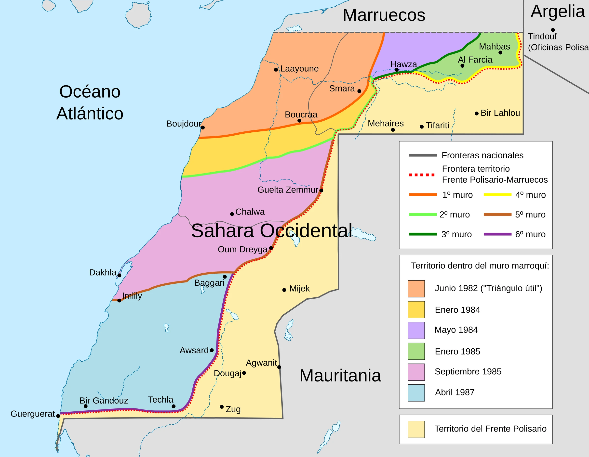

Es un conjunto de ocho muros defensivos de una longitud superior a los 2720 km construidos por Marruecos en el territorio ocupado del Sahara Occidental. Es una zona militar con búnkeres, vallas y campos de minas, construida con el fin de proteger el territorio efectivamente ocupado por Marruecos de las incursiones del Frente Polisario, y evitar la vuelta de los refugiados saharauis al territorio.

<blockquote class="tweet" data-tweet-id="2088604765974417538">
  <a class="tweet-author" href="https://x.com/NestorSiurana/status/2088604765974417538" target="_blank" rel="noopener">
    
    Néstor Siurana
    @NestorSiurana
  </a>
  
Breve y muy buen vídeo explicativo. 
 
El muro más largo del mundo después de la Gran Muralla China, es el muro construido por Marruecos para sellar su ocupación al Sáhara Occidental. 
 
Un muro de 2.700km, rodeado por 9 millones de minas y vigilado por más de 130.000 soldados. 
 
El […]

  <video class="tweet-media tweet-media-video" controls preload="none" playsinline poster="/tweets/img-htjw3bp3siaau1wi.jpg"><source src="https://video.twimg.com/amplify_video/2088604118398967808/vid/avc1/720x1280/IkJccnoo_yZ-BL6F.mp4" type="video/mp4" /><source src="/tweets/720x1280-ikjccnoo_yz-bl6f.mp4" type="video/mp4" />Tu navegador no admite vídeo. <a href="https://x.com/NestorSiurana/status/2088604765974417538" target="_blank" rel="noopener">Verlo en X</a></video>
  <a class="tweet-date" href="https://x.com/NestorSiurana/status/2088604765974417538" target="_blank" rel="noopener">15 de agosto de 2026</a>
</blockquote>
