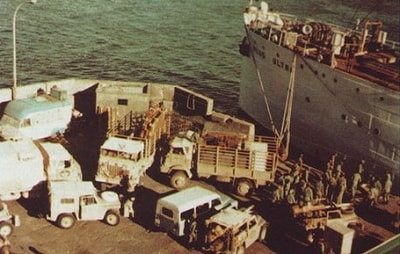
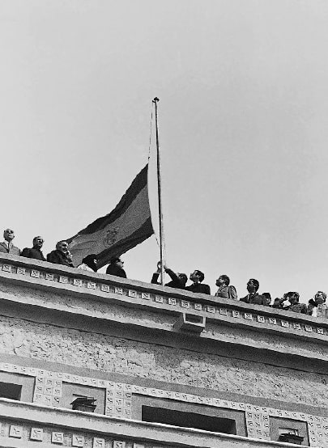

La Operación Golondrina fue el plan militar diseñado por España desde <mark>mayo de 1975</mark> para evacuar de forma urgente el Sáhara Occidental: tropas, civiles y propiedades. En mayo, España solicitó una misión visitadora de la ONU al Sáhara -la cual estaría a favor de la autodeterminación-. En esta visita, fueron recibidos con fuertes protestas contra España y la captura de varios militares, forzando la creación de la Operación Golondrina.

El presidente Arias Navarro ordenó al Alto Estado Mayor iniciar la salida a partir del 10 de noviembre de ese año, y aunque se habían previsto <mark>dos escenarios</mark> —una retirada tranquila en 160 días o una salida forzosa en solo 30—, finalmente se pudo ejecutar el plan más pausado, con la evacuación de unos 10.500 civiles y cerca de 12.000 militares, junto a miles de toneladas de material y vehículos.

<mark>La negociación con Marruecos corrió a cargo de José Solís, ministro-secretario general del Movimiento y amigo personal de Hassan II</mark>, en lugar del ministro de Exteriores Pedro Cortina, partidario de la autodeterminación saharaui. Solís se entrevistó con el monarca marroquí para comunicarle que España estaba dispuesta a abandonar el territorio de inmediato. La operación, arrancó formalmente el 28 de octubre de 1975 con la cesión de los puestos fronterizos de Hausa, Edchería y Mahbes, ocupados por Marruecos dos días después sin ninguna reacción diplomática española.

En los meses siguientes, mientras las tropas españolas iban replegándose y cediendo posiciones a las Fuerzas Armadas Reales marroquíes, el príncipe Juan Carlos visitó inesperadamente El Aaiún el 2 de noviembre para calmar el malestar dentro del ejército. Marruecos y Mauritania fueron ocupando progresivamente las principales ciudades del territorio —Smara, El Aaiún, La Güera y Villa Cisneros— entre finales de 1975 y enero de 1976. El proceso concluyó el 28 de febrero de 1976, cuando el teniente coronel Valdés arrió por última vez la bandera española en El Aaiún, izándose la marroquí en su lugar. Testimonios de quienes vivieron la retirada, como el de Pepe Taboada[^1], describen el episodio como una salida humillante para un ejército que estaba preparado para resistir pero recibió órdenes de entregar el territorio.

[^1]: https://saharaoccidental.es/quizas-te-interese/operacion-golondrina/
