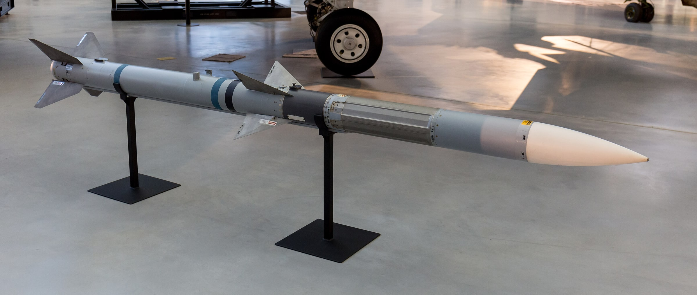
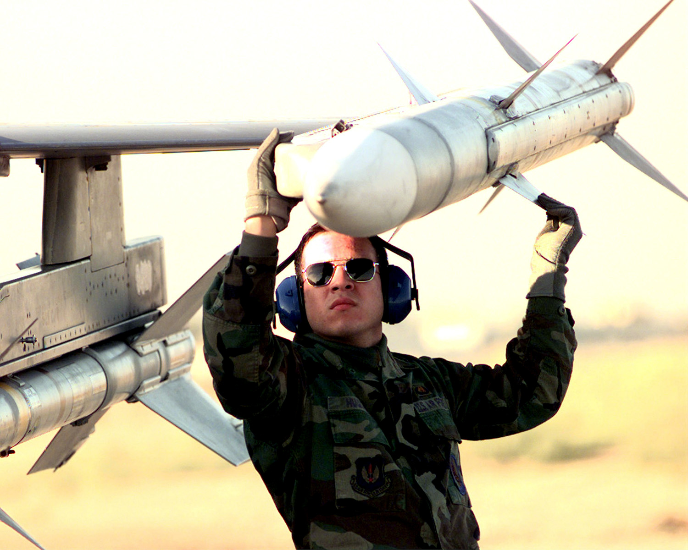

*Un AIM-120 en el museo Steven F. Udvar-Hazy, en Virginia: radomo blanco, la sección de guiado sin pintar, las alas en el centro y las aletas de la cola (foto: Balon Greyjoy, CC0).*

*Un armero comprueba un AIM-120 en el soporte de la punta del ala de un F-16 (foto: SSgt Vince Parker, Fuerza Aérea de EE. UU.).*

| | |
|---|---|
| **País** | 🇺🇸 Estados Unidos |
| **Fabricante** | Raytheon (RTX) |
| **Tipo** | Misil aire-aire de medio alcance |
| **Guiado** | Inercial con correcciones del avión y, al final, su propio radar |
| **Peso / longitud** | Unos 160 kg / 3,65 m |
| **Warhead** | Unos 20 kg |
| **Alcance** | Más de 100 km, según la versión |
| **En servicio** | Desde 1991 |
| **Lo llevan** | [FQ-44A Fury](/uas/fq-44a-fury) (dos en el prototipo, cuatro en el de serie) |

El AMRAAM (*Advanced Medium-Range Air-to-Air Missile*) es el misil aire-aire de medio alcance de Estados Unidos y de buena parte de la OTAN ([Wikipedia](https://en.wikipedia.org/wiki/AIM-120_AMRAAM)). Sustituyó al AIM-7 Sparrow, que necesitaba que el avión siguiera iluminando el blanco con su radar hasta el impacto. El AIM-120 lleva su propio radar: el avión lo lanza, le pasa correcciones por el camino y, en el tramo final, el misil busca el blanco solo. Por eso se dice que es de tipo *dispara y olvida*, y el avión puede apartarse o atacar a otro blanco.

Entró en servicio en 1991 y su primer derribo fue en diciembre de 1992, cuando un F-16 estadounidense abatió un MiG-25 iraquí. Lo llevan el F-15, el F-16, el F/A-18, el F-22 y el F-35, entre otros, y desde tierra lo dispara el sistema NASAMS, también en Ucrania. En julio de 2026, el [FQ-44A Fury](/uas/fq-44a-fury) de Anduril fue el primer dron CCA en [disparar un AIM-120](https://www.twz.com/air/yfq-44a-fury-fighter-drone-has-fired-its-first-aim-120-amraam-missile), sobre el desierto de Mojave. En las pruebas en tierra lleva la versión de instrucción, gris con bandas azules.

## Fuentes

* **Wikipedia** - AIM-120 AMRAAM ([fuente](https://en.wikipedia.org/wiki/AIM-120_AMRAAM))
* **The War Zone**, julio 2026 - YFQ-44A Fury 'Fighter Drone' Has Fired Its First AIM-120 AMRAAM Missile ([fuente](https://www.twz.com/air/yfq-44a-fury-fighter-drone-has-fired-its-first-aim-120-amraam-missile))
