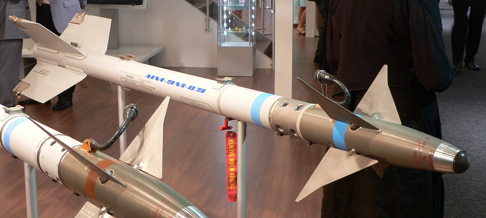
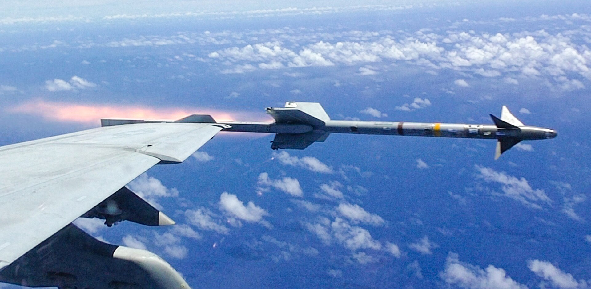
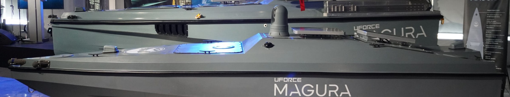
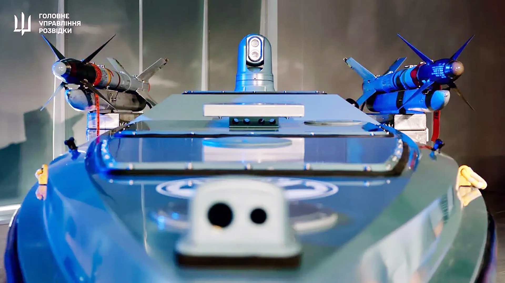

*Un AIM-9M Sidewinder en una exposición: cuerpo blanco, la cúpula del buscador infrarrojo en la punta, las aletas de control delanteras y, en la cola, las cuatro aletas fijas (foto: David Monniaux, CC BY-SA).*

*Un AIM-9M sale del ala de un F/A-18F del VFA-102, en junio de 2015 (foto: Armada de EE. UU.).*

*Un AIM-9M sobre su lanzador en la cubierta del Magura V7, detrás de un V5, en una exposición (foto: Militarnyi).*

*El Magura V7 de frente, con un AIM-9M a cada lado de la cámara; el de la derecha es azul, de instrucción (foto: Inteligencia militar de Ucrania, GUR).*

| | |
|---|---|
| **País** | 🇺🇸 Estados Unidos |
| **Fabricante** | Raytheon (RTX) |
| **Tipo** | Misil aire-aire de corto alcance |
| **Guiado** | Infrarrojo: busca el calor del blanco |
| **Peso / longitud** | 86 kg / 2,89 m |
| **Warhead** | 9,4 kg, de fragmentación |
| **Alcance** | Hasta unos 35 km, según la fuente |
| **En servicio** | El Sidewinder, desde 1956; el AIM-9M, desde los años 80 |
| **Lo llevan** | [Magura V7](/uas/magura-v5-v7) (dos) |

El AIM-9 Sidewinder es el misil aire-aire de corto alcance más usado del mundo ([Wikipedia](https://en.wikipedia.org/wiki/AIM-9_Sidewinder)). Lleva en la punta un buscador infrarrojo que persigue el calor de los motores del blanco, de modo que, una vez lanzado, el misil sigue solo: es de tipo *dispara y olvida*. Nació en la Armada de EE. UU. en China Lake, con un primer disparo en 1952, y entró en servicio en 1956.

El AIM-9M es la versión que se estandarizó tras el AIM-9L, el primero capaz de atacar a un avión desde cualquier ángulo, no solo por detrás. El M mejoró el rechazo de las bengalas y de otros señuelos, y su motor echa poco humo, lo que hace más difícil verlo venir. Fue la versión principal de la guerra del Golfo de 1991. Sigue en servicio en muchos países, aunque en la Armada de EE. UU. lo ha ido sustituyendo el AIM-9X, de 2003.

En mayo de 2025, la Inteligencia militar ucraniana (GUR) dijo que había derribado dos Su-30 rusos con misiles AIM-9 disparados desde el [Magura V7](/uas/magura-v5-v7), un dron naval, el primer caso conocido de un caza abatido desde un dron. Ucrania habló al principio de AIM-9M; su jefe, Kyrylo Budanov, dijo después a The War Zone que eran AIM-9X. Rusia no ha reconocido las pérdidas y no hay confirmación independiente.

## Fuentes

* **Wikipedia** - AIM-9 Sidewinder ([fuente](https://en.wikipedia.org/wiki/AIM-9_Sidewinder))
* **Naval News**, mayo 2025 - First Image Of Ukraine's Sidewinder-Armed Magura V7 Surface Drone ([fuente](https://www.navalnews.com/naval-news/2025/05/first-image-of-ukraines-sidewinder-armed-magura-v7-surface-drone/))
* **Janes**, mayo 2025 - Update: Ukrainian unmanned surface vessels down Russian fast jets ([fuente](https://www.janes.com/osint-insights/defence-news/sea/update-ukrainian-unmanned-surface-vessels-down-russian-fast-jets))
