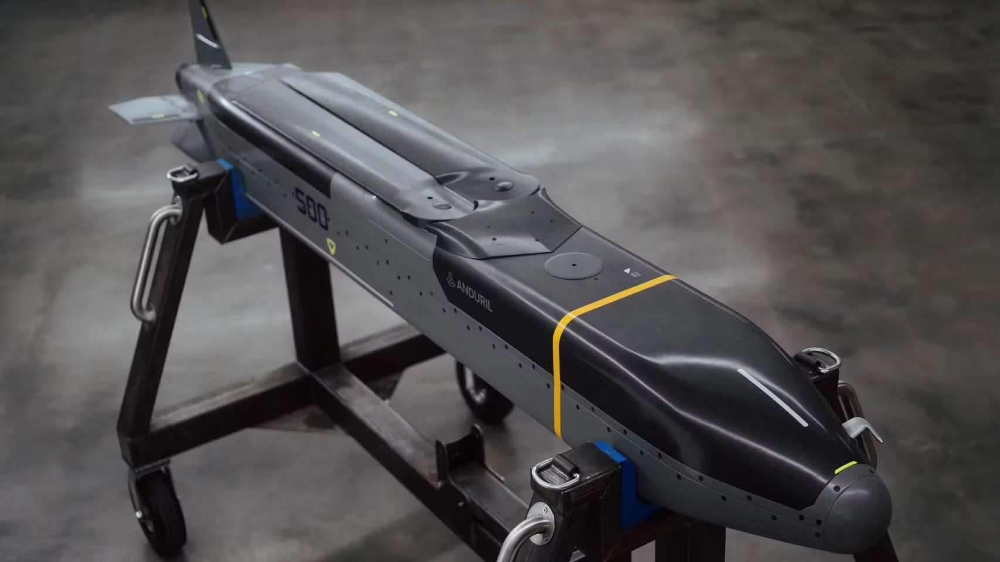
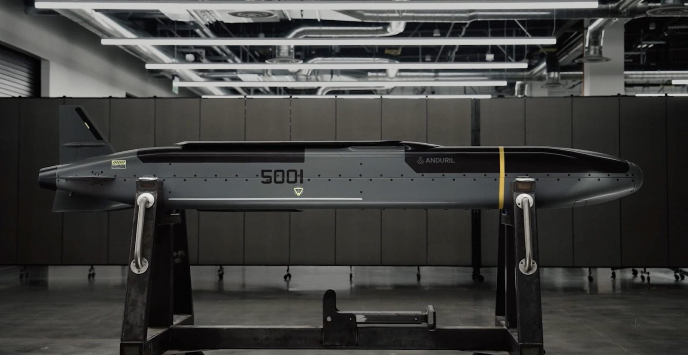

*Misil Barracuda 500 (Anduril Industries)*

*Misil Barracuda 500 (Anduril Industries)*

|                     |                                                                                            |
| ------------------- | ------------------------------------------------------------------------------------------ |
| **País**            | 🇺🇸 Estados Unidos                                                                        |
| **Fabricante**      | Anduril Industries                                                                         |
| **Tipo**            | Misil de crucero                                                                           |
| **Guiado**          | GPS e inercial, con el programa Lattice de Anduril para volar en grupo y cambiar de blanco |
| **Peso / longitud** | Entre 180 y 225 kg; unos 4 m                                                               |
| **Warhead**         | Más de 45 kg (fabricante)                                                                  |
| **Alcance**         | Más de 900 km (fabricante)                                                                 |
| **En servicio**     | En producción; la versión aire-superficie se llama AGM-189A                                |
| **Lo llevan**       | [FQ-44A Fury](/uas/fq-44a-fury) (en preparación)                                         |

El Barracuda es una familia de misiles de crucero que Anduril presentó en 2024 ([The Aviationist](https://theaviationist.com/2024/09/13/anduril-unveils-barracuda-family-of-autonomous-air-vehicles/)). La idea es la contraria a la de misiles como el JASSM o el Tomahawk, que cuestan millones: un misil más sencillo, hecho con menos piezas y más fácil de fabricar, para poder comprarlo por miles. Hay tres tamaños en la [familia](https://www.anduril.com/barracuda), el Barracuda-100, el 250 y el 500, que se pueden lanzar desde aviones, desde tierra o desde contenedores. El Barracuda-500, el mayor, lleva un pequeño turborreactor, vuela a unos 900 km/h y puede pasar más de dos horas en el aire esperando su blanco.

Anduril quiere fabricar miles al año en su fábrica Arsenal-1 de Ohio, la misma del [FQ-44A Fury](/uas/fq-44a-fury), y la Fuerza Aérea [apoya fabricar hasta 8.000 al año](https://www.armyrecognition.com/news/aerospace-news/2026/u-s-air-force-backs-anduril-barracuda-500-for-up-to-8000-affordable-cruise-missiles-a-year). En septiembre de 2026 Anduril dijo que está preparando el Barracuda-500 para el Fury; [aún no ha volado con él](https://theaviationist.com/2026/09/16/andurils-yfq-44a-fury-air-to-ground-munitions/).

## Fuentes

- **Wikipedia** - ([fuente](https://en.wikipedia.org/wiki/Barracuda-M)) 
* **The Aviationist**, septiembre 2024 - Anduril Unveils Barracuda Family of Autonomous Air Vehicles ([fuente](https://theaviationist.com/2024/09/13/anduril-unveils-barracuda-family-of-autonomous-air-vehicles/))
* **Designation-Systems.net** - AGM-189 ([fuente](https://designation-systems.net/dusrm/m-189.html))
* **Army Recognition**, 2026 - U.S. Air Force backs Anduril Barracuda-500 for up to 8,000 affordable cruise missiles a year ([fuente](https://www.armyrecognition.com/news/aerospace-news/2026/u-s-air-force-backs-anduril-barracuda-500-for-up-to-8000-affordable-cruise-missiles-a-year))
* **The Aviationist**, septiembre 2026 - Anduril's YFQ-44A Fury Expands Its Weapons Options With Air-to-Ground Munitions ([fuente](https://theaviationist.com/2026/09/16/andurils-yfq-44a-fury-air-to-ground-munitions/))
