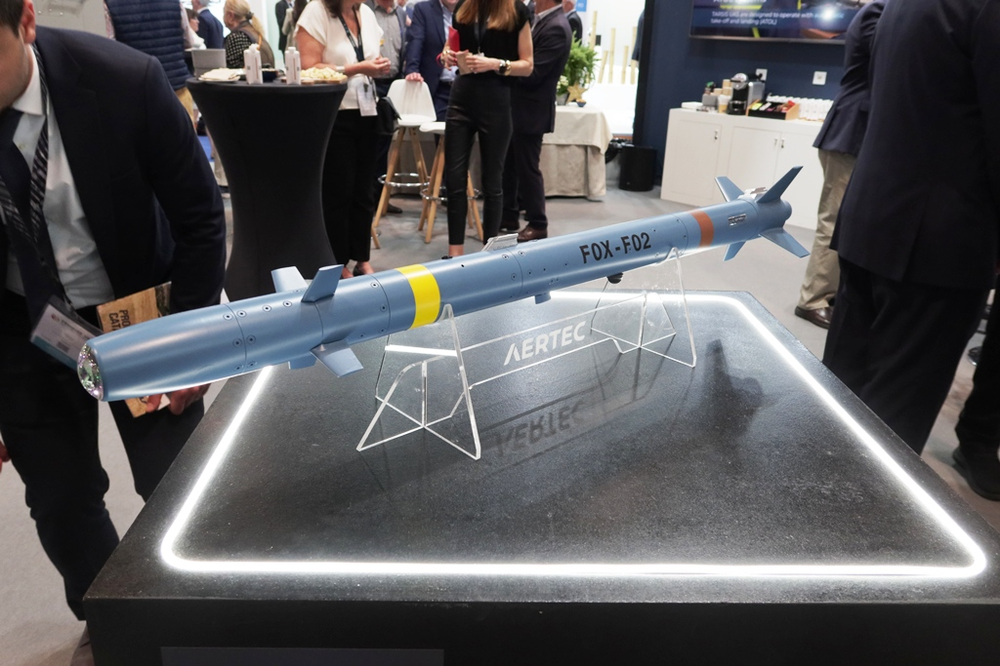
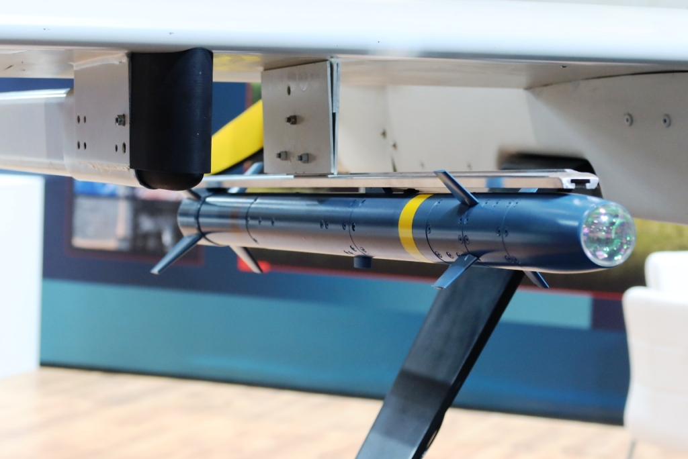
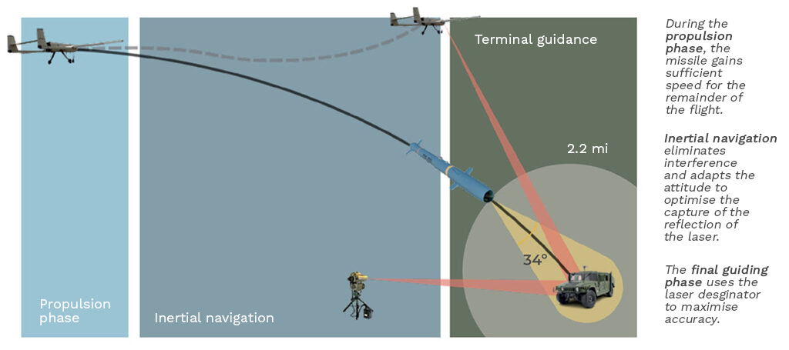

*Un Fox en el puesto de AERTEC de la feria FEINDEF de 2025, en Madrid (foto: P. Valpolini, EDR Magazine).*

*Un Fox colgado de su raíl bajo el ala del TARSIS-W, en la FEINDEF de 2023 (foto: EDR Magazine).*

*Cómo se guía: tras el impulso del motor vuela por inercia y, al final, sigue el láser que apunta el dron u otro designador (esquema: AERTEC).*

|                     |                                                                                  |
| ------------------- | -------------------------------------------------------------------------------- |
| **País**            | 🇪🇸 España                                                                      |
| **Fabricante**      | AERTEC (desde 2025, Indra) e Instalaza                                           |
| **Tipo**            | Micromisil guiado por láser                                                      |
| **Guiado**          | Navegación inercial (INS) y láser semiactivo                                     |
| **Peso / longitud** | 3 kg / 90 cm                                                                     |
| **Warhead**         | 500 g, explosiva con metralla, derivada de la del lanzagranadas C90 de Instalaza |
| **Alcance**         | Hasta 4 km, según la altura de disparo                                           |
| **En servicio**     | No: en ensayos de calificación                                                   |
| **Lo llevan**       | [TARSIS-W](/uas/tarsis)                                                        |

El Fox es un micromisil que AERTEC hizo para su dron de Clase I, el [TARSIS-W](/uas/tarsis). Está pensado para vehículos sin blindaje, infantería y puestos de mando, y para la autodefensa del propio TARSIS ([TEDAE](https://tedae.org/en/?p=16274)).

AERTEC lo diseñó entero, incluido el kit de guiado y el buscador láser, dentro de un proyecto de la Dirección General de Armamento y Material (DGAM) para armar drones pequeños; Instalaza fabricó la cabeza de combate y el motor cohete. En octubre de 2024 AERTEC dio por terminado el contrato de desarrollo, con disparos de prueba en el CENAD San Gregorio y en el Polígono de Tiro de las Bardenas Reales ([TEDAE](https://tedae.org/en/?p=16274)). La calificación, que incluye hasta 100 disparos desde tierra y aire, empezó con un año de retraso y se espera que termine hacia 2027 ([EDR Magazine](https://www.edrmagazine.eu/feindef-2025-aertec-and-instalaza-air-launched-ordnances-for-uavs)).

Se dispara desde un lanzador bajo el ala y vuela a entre 0,2 y 0,7 de Mach. Hasta el último tramo se guía solo, por inercia, pero el buscador de láser semiactivo, que ve a unos 3 km y con un campo de ±17°, necesita que alguien ilumine el blanco hasta el impacto, sea el propio dron u otro. AERTEC da un error probable de 2,5 m. El TARSIS-W lleva dos lanzadores, uno bajo cada ala, con dos Fox cada uno. No tiene restricciones ITAR, es decir, no depende de permisos de exportación de EE. UU.

## Fuentes

* **AERTEC** - Fox ([fuente](https://aertecsolutions.com/en/defence-systems/fox))
* **AERTEC** - TARSIS-W. Soluciones para integración de armamento ligero (folleto) ([fuente](https://aertecsolutions.com/wp-content/uploads/2025/05/AERTEC_TARSIS_W_ES-uas.pdf))
* **EDR Magazine**, mayo 2023 - µASM A-Fox: a laser-guided micromissile for Class 1 UAVs by Aertec ([fuente](https://www.edrmagazine.eu/?p=29777))
* **TEDAE**, octubre 2024 - AERTEC concluye con éxito el contrato de desarrollo de su micromisil FOX I ([fuente](https://tedae.org/en/?p=16274))
* **EDR Magazine**, mayo 2025 - FEINDEF 2025: Aertec and Instalaza air-launched ordnances for UAVs ([fuente](https://www.edrmagazine.eu/feindef-2025-aertec-and-instalaza-air-launched-ordnances-for-uavs))
